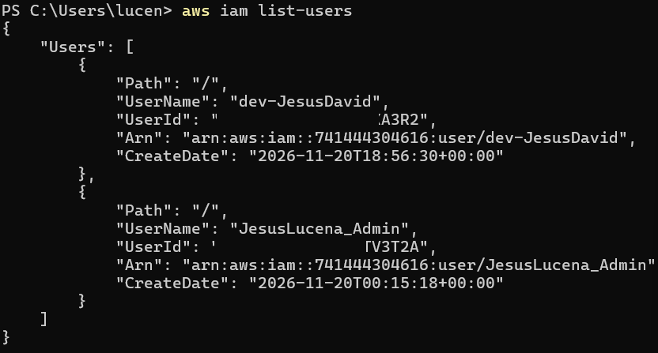
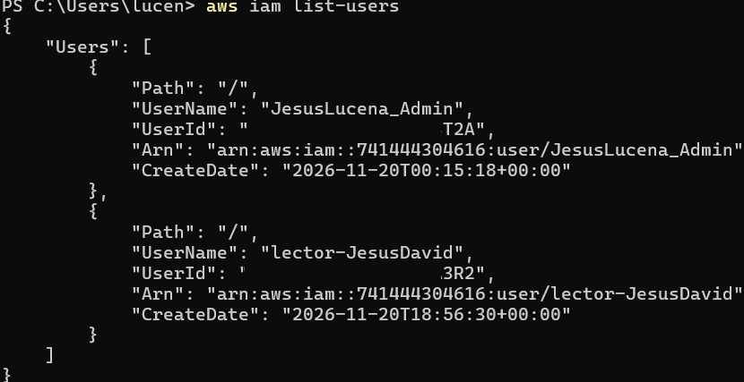
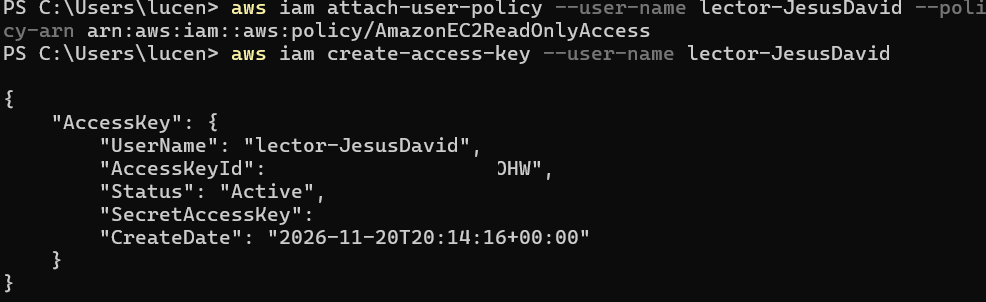
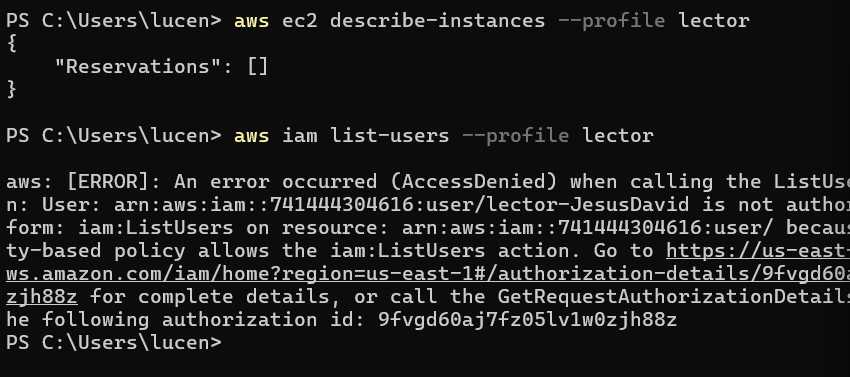
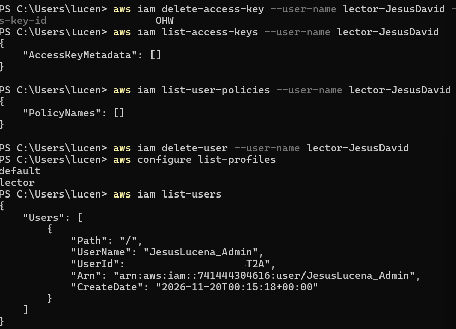
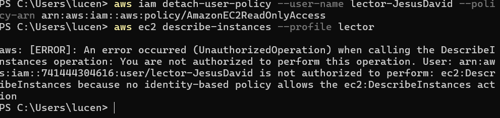
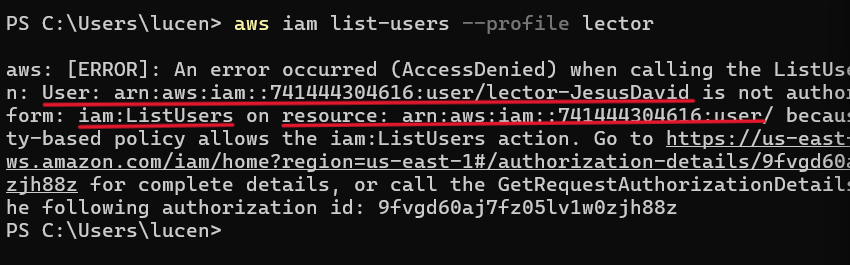

# AWS IAM | Ciclo de vida de un usuario

## Descripción

Práctica de administración de usuarios en AWS Identity and Access Management (IAM) mediante AWS CLI.

El ejercicio consiste en crear, consultar, modificar, asignar permisos, validar accesos y eliminar un usuario IAM, aplicando el principio de mínimo privilegio (*Least Privilege*).

## Objetivos

- Administrar usuarios IAM desde AWS CLI.
- Comprender la estructura de usuarios, ARN y etiquetas.
- Asignar y consultar políticas administradas.
- Configurar perfiles independientes en AWS CLI.
- Validar permisos mediante operaciones permitidas y denegadas.
- Revocar permisos y eliminar usuarios de forma segura.

## Tecnologías utilizadas

- AWS Identity and Access Management (IAM).
- AWS Command Line Interface (AWS CLI v2).
- Windows PowerShell.
- JSON.

## Desarrollo de la actividad

### 1. Creación y consulta del usuario

Se crea un usuario IAM y se verifica su existencia mediante los comandos de consulta de usuarios.

**Evidencia:**

### 2. Modificación del usuario

Se agrega una etiqueta para identificar su área de trabajo y posteriormente se actualiza su nombre.

**Evidencia:**

### 3. Asignación de permisos

Se adjunta la política administrada `AmazonEC2ReadOnlyAccess`, que permite consultar recursos de Amazon EC2.

**Evidencia:**

### 4. Validación del principio de mínimo privilegio

Se configura un perfil independiente para el usuario lector y se realizan dos pruebas:

- **Acceso permitido:** consulta de instancias EC2 mediante `ec2:DescribeInstances`.
- **Acceso denegado:** consulta de usuarios IAM mediante `iam:ListUsers`.

**Evidencia de acceso permitido:**

**Evidencia de acceso denegado:**

### 5. Revocación de permisos

Se elimina la política `AmazonEC2ReadOnlyAccess` utilizando el perfil administrador y se repite la consulta de instancias EC2 para comprobar que el acceso dejó de estar autorizado.

**Evidencia:**

### 6. Eliminación del usuario

Se eliminan las llaves de acceso y las políticas asociadas antes de borrar el usuario IAM. Finalmente, se comprueba que ya no aparece en el listado de usuarios.

También se elimina el perfil local `lector` de los archivos de configuración de AWS CLI.

**Evidencia:**

## Principio de seguridad aplicado

**Least Privilege (mínimo privilegio):**

Cada usuario debe disponer únicamente de los permisos necesarios para realizar sus funciones.

En esta actividad, el usuario lector recibió permisos de consulta sobre EC2, sin autorización para administrar usuarios IAM.

## Preguntas de reflexión

**1. ¿Qué podía hacer el usuario justo después de crearlo, antes de adjuntarle una política? ¿Por qué?**

No podía acceder a ningún servicio ni realizar acciones sobre los recursos de AWS

**2. En el error del paso 13, ¿qué tres datos te dice el mensaje?**

La acción que se intentó ejecutar.

El recurso sobre el que se intentó realizar la acción.

El usuario o identidad que no tiene los permisos necesarios.

**3. ¿Por qué cambió el ARN al renombrar el usuario?**

Porque el nombre del usuario forma parte de su ARN

**4. ¿Por qué AWS obliga a borrar las llaves antes de borrar el usuario?**

Eliminarlas evita dejar credenciales activas o innecesarias y permite realizar una eliminación segura del usuario.

**5. ¿Qué pasaría si le hubieras dado AdministratorAccess en vez de solo lectura? ¿En qué caso real estaría justificado?**

El usuario tendría permisos administrativos para gestionar prácticamente todos los servicios y recursos

## Conclusiones

Aprendí que IAM permite administrar los usuarios, grupos, roles y permisos dentro de AWS, controlando qué acciones puede realizar cada identidad sobre los recursos.

## Seguridad

- No almacenar Access Keys ni Secret Access Keys en el repositorio.
- No subir archivos de credenciales de AWS.
- No publicar información sensible de la cuenta.
- Verificar que las llaves utilizadas durante la práctica hayan sido eliminadas.

---

**Actividad:** Ciclo de vida de un usuario IAM  
**Servicio:** AWS IAM  
**Herramienta:** AWS CLI v2  
**Estado:** Evidencias y reflexiones pendientes de completar.